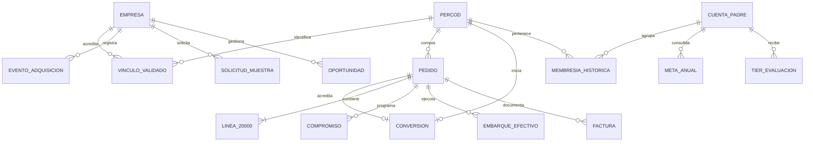

# Modelo entidad-relación y contratos

Para el almacenamiento y las restricciones ejecutables vigentes, consultar [persistencia RDS](persistencia_rds.md). Las referencias a FK, índices y DDL describen el diseño relacional de Fase 2. Las restricciones se trasladan a contratos R y a validadores de dominio al habilitar cada conjunto de datos.

## Modelo conceptual

El mínimo de una línea elegible se comprueba en publicación de snapshot. Las cardinalidades del diagrama pertenecen al modelo de destino.

## Modelo lógico

| Relación | Clave, grano y comportamiento |
|---|---|
| Identidad | `empresa.empresa_id` existe desde la prospección. `persona_operativa.percod` guarda la identidad oficial como texto opaco hasta validar su representación y admite país institucional para clientes históricos sin ficha CRM. `empresa_percod` admite varias identidades validadas para una empresa cuando exista evidencia, y una empresa vigente por PerCod. Vigencia semiabierta [desde, hasta). Un cambio cierra el vínculo y crea otro dentro de la misma transacción. |
| Jerarquía | `cuenta_padre` es una entidad diferente de PerCod. `cuenta_padre_miembro` admite historial y un padre vigente por PerCod. Se deja vacía hasta contar con homologación. El cruce por fechas se valida con vigencias de fuente, sin heurísticas de nombres. |
| Contactos y asignaciones | `empresa_contacto` es N:M. `asignacion_comercial` conserva intervalos por comercial y empresa, con atención compartida. Identidad y permisos proceden del catálogo institucional. Actores y procesos se distinguen por clase. |
| Adquisición | `adquisicion_evento` conserva Contacto, Prospecto y Lead, etapa anterior, evidencia, autor y fechas. Primera etapa sin anterior. Validar secuencia en servidor y preservar eventos en orden efectivo. |
| Conversión | `conversion` tiene un registro por PerCod y FK compuesta que prueba que el pedido pertenece al mismo PerCod. Fecha efectiva derivada de la creación en `pedido_ref`. `pedido_estado_observado` registra anulación y otros estados sin borrar la referencia de conversión. |
| Actividad | Métricas por PerCod y corte. `regla_actividad` guarda parámetros y aprobación. `actividad_evaluada` admite versiones sin alterar adquisición ni conversión. Requiere versión aprobada para publicar un estado. |
| Snapshots | `corte_operacional` contiene manifiesto de fuentes, versiones y corte. `pedido_corte` conserva cabeceras presentes y `pedido_linea` detalle elegible. Nunca sumar entre cortes. `pedido_ref` es estable entre cortes y permite FK con datos CRM. |
| Compromiso | `fecha_embarque_origen` conserva candidato por cabecera/línea, campo y texto original. `compromiso` admite N observaciones contractuales por pedido y corte, con día o mes. `compromiso_linea` asigna masa o valor a líneas elegibles con evidencia. |
| Lote, ejecución y FCC | `linea_lote` N:M por corte. `embarque_linea` asigna cantidades efectivas a líneas 20000. `cumplimiento_asignacion` enlaza parcialidades con compromisos por línea. `factura_observada` documenta la fecha sin participar en conversión ni cumplimiento. `fcc_lote` conserva versión de fuente y base física; `margen_anticipado` conserva grano declarado de cabecera o línea. |
| Muestras | Solicitud por empresa/contacto → una o varias muestras. Remisiones y muestras relacionadas mediante detalle, con evaluaciones por muestra y remisión opcional. Puente N:M con pedidos tras confirmación de la relación. Cardinalidades propuestas, sujetas a revisión con Comercial, Calidad y Logística. |
| Oportunidades | Sugerencia → decisión individual → oportunidad gestionable si aceptada. El DDL exige aceptación, empresa y tipo coherentes. Una oportunidad de origen manual tiene autor, fecha y criterio; eventos registran acciones. La aceptación se ejecutará con permiso específico y transacción que registre decisión y alta. |
| Tier y meta | Tier versionado y evaluado exclusivamente por padre. Presupuesto anual por cliente de la fuente, con vínculo explícito al padre cuando exista. La clave única impide aplicar la misma meta aprobada a más de una fila del padre en un año y versión. |
| Catálogos | País ISO 3166-1 alfa-2 y equivalencias por fuente y vigencia. Tipologías iniciales previstas: importador, tostador, distribuidor y cadena. Se dejan sin carga. País de empresa y país de destino se consultan en roles separados. |

### Prevención de inconsistencias

Los servicios futuros deben bloquear por entidad dentro de la transacción y verificar solapamientos de intervalos históricos en PerCod, membresía, equivalencias y asignaciones por comercial. Las claves vigentes cubren un vínculo abierto por PerCod, pero un índice único no excluye intervalos históricos solapados. Validar autorización de actores, claridad de la evidencia, invariantes de eventos y estados aprobados en el servidor. Las claves de origen se serializan con formato canónico reversible (incluido contexto de compañía cuando aplique); conservar columnas originales en la exportación y evitar deduplicación por texto descriptivo. Fecha literal de precisión diaria puede representarse técnicamente a medianoche con `precision_creacion = DIA`; no atribuir una hora al dato. Conservar zona y representación fuente en manifiesto.

## Contratos comerciales y operacionales

1. **Universo.** Cualquier pedido con línea original 20000 pertenece a Diferenciados. Una cabecera puede formar parte del universo por existencia de al menos una línea elegible. El detalle se filtra antes de agregar y cualquier valor de cabecera se conserva como control fuera de la suma. Si el valor por línea falta, mostrar ausencia; no repartir sin evidencia. 20000 → 21000 es una transformación excluida. La identificación de campos originales, llave y formatos sigue pendiente de evidencia.
2. **Conversión.** Encontrar primera creación por PerCod en la historia disponible. Para fechas iguales, usar clave de origen estable como desempate técnico. No inferir etapas anteriores en clientes históricos. Si la cobertura empieza tarde, señalar la primera compra observada y limitar el uso de cohortes históricas. Conservar anulación como estado/evento observado, sin reversión automática. Si se recibe historia anterior a la primera compra registrada, tramitar corrección explícita con evidencia y rastro de la referencia anterior antes de modificar la conversión. Registrar la corrección en `conversion_correccion` y actualizar la referencia vigente en la misma transacción.
3. **Actividad.** Por corte, recencia = tiempo desde la última creación elegible observada, frecuencia = pedidos distintos por período declarado, e intervalos = diferencia entre creaciones consecutivas. Mostrar la cobertura y el tratamiento de cancelaciones de cada serie. Condición histórica y actividad son independientes; Cliente Nuevo significa cohorte de primera compra en el período. Preparar ventanas y parámetros, sin aplicar cortes de inactividad o reactivación.
4. **Fechas.** Creación = alta comercial. Compromiso = fecha contractual o mes YYYY-MM. Embarque efectivo = ejecución. Facturación = hecho documental posterior según evidencia. Retener cabecera y detalle sin precedencia, incluso en discrepancias. Solo crear compromisos publicados con semántica verificada. El embarque efectivo asignado por línea/compromiso es el hecho de cumplimiento. Validar masa y período comparables, fecha de corte, manejo de parciales y tolerancias antes de calcular atraso o cumplimiento. Si falta el puente, publicar hechos separados e indicar cumplimiento no evaluable.
5. **Granos y conciliación.** Agregar una vez por línea elegible antes de unir lotes, compromisos, embarques, muestras u otros hechos. Comprobar asignaciones acumuladas contra masa real y comprometida, incluidas parciales y envíos sin compromiso. Agregar valor por moneda y solo con precios/importes verificados. Mantener margen anticipado y MNFCC separado por naturaleza y unidad. Promedio unitario = suma de margen × masa física comparable / suma de masa comparable de registros con margen. Declarar cobertura y fuente de conversión. No extrapolar datos faltantes.
6. **Presupuesto anual.** Fuente, versión, año, identificador de cliente de la fuente, sacos, margen US¢/lb y MNFCC con unidad y definición explícitas. La fila de origen puede existir sin homologación del padre; queda sin consolidar hasta validación. Si varias filas pretenden la misma meta padre, resolver duplicidad en origen antes de publicar. Diferenciar sin archivo, meta ausente, fila sin homologar, cero registrado y denominador comparable. Conservar ejecución no presupuestada y vistas separadas por creación y embarque efectivo, junto con compromisos como contexto. Fecha oficial de imputación y definición del MNFCC presupuestado se confirmarán con el contrato. Ponderar márgenes unitarios con masa verificable.
7. **Geografía.** Homologar por código fuente con padrón ISO, vigencia y evidencia; duplicados o códigos sin equivalencia se reportan como desconocidos. Trazar país de empresa, contacto y destino de forma independiente. Diseñar filtros por país en módulos principales; regiones y mercados especiales quedan diferidos.
8. **Muestras.** Capturar solicitud, muestra, atributos de producto/perfil, remisión, courier, destino, evaluación y pedido si existe. Los eventos se registran con fuente, fecha real y persona responsable de registrar. Los atributos candidatos no fijan el circuito. Pendientes el catálogo de resultados, estados, SLA, cardinalidades y responsables. Una muestra no origina por sí sola una conversión.
9. **Oportunidades.** Adquisición para empresa sin primer pedido, cross-selling para nuevos productos/orígenes/perfiles/certificaciones/programas, up-selling para mayor volumen o valor. Conservar origen, criterio, responsable, decisión y fecha. Verificar contexto de cliente en aceptación y publicar hallazgos analíticos como sugerencias pendientes hasta decisión manual. La oportunidad conserva su propio historial.
10. **Segmentación.** Trabajar con volumen, margen y potencial de padres homologados en el mismo corte. Evaluar robustez de cobertura, transformaciones de escala, pesos interpretables y estabilidad por cortes históricos. Comparar método por percentiles con puntuación ponderada y revisar sensibilidad antes de proponer umbrales. Conservar sugerencias y asignación aprobada con versión, explicación y vigencia. Variables complementarias requieren aprobación. Lead scoring queda fuera de la primera versión.

## Matriz de reglas

| Tema | Confirmado por decisiones del 23/11/2026 | Pendiente y responsable de validar |
|---|---|---|
| Universo | 20000 original y suma desde detalle elegible | TI y Analítica: nombres, formatos, llaves, fechas y cardinalidades físicas. |
| Identidad | PerCod operativo y alta prospectada interna, vínculo auditado | Comercial y Datos: tipo del código, evidencia y padrón padre/hija. Mientras tanto, resultados oficiales por PerCod. |
| Conversión | Primera creación y traza de cancelación sin reversión | Comercial: política de reversión futura y correcciones de historia. TI: estados y cobertura. |
| Actividad | Recencia, frecuencia e intervalos | Comercial y Analítica: umbrales y definición publicable por versión. |
| Compromisos | Varias fechas por pedido y efectivo como hecho de cumplimiento | Logística y TI: semántica cabecera/detalle, vínculos, parciales, tolerancias. |
| Muestras | Contrato de captura y evaluación de circuito | Comercial, Calidad y Logística: roles, catálogo, procedimientos, plazos, vínculos. |
| Tier | Padre, volumen, margen, potencial. Clasificación sin activar | Comercial y Analítica: homologación, metodología, pesos, cortes y aprobación. |
| Presupuesto | Anual por cliente, consolida a padre tras homologación | Planeación: archivo, unidad/definición MNFCC, regla temporal y autorización de versión. |
| Geografía | ISO y prioridad país con roles separados | Datos: padrón ISO, equivalencias por fuente y cobertura. |
| Oportunidades | Adquisición, cross-selling, up-selling y aceptación manual | Jefatura: permisos, criterios analíticos y catálogo de acciones gestionables. |
| Lead scoring | Excluido de primera versión | Reevaluación posterior a criterio comercial. |
